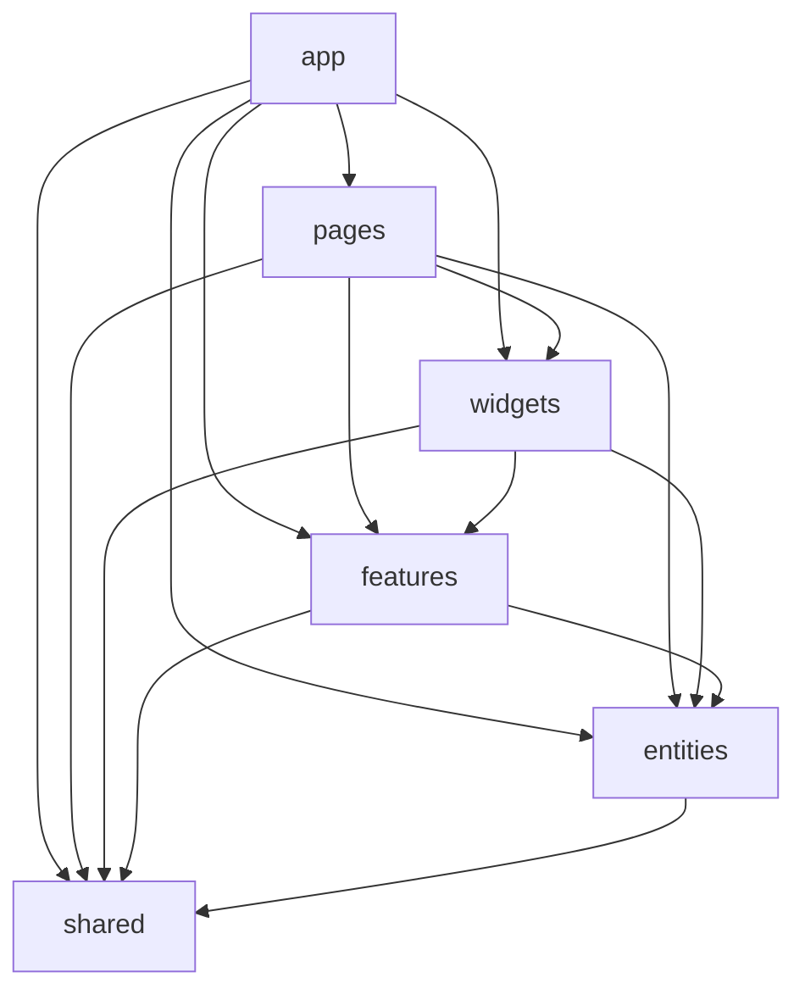

# Vue Lottery — лабораторні №5 і №6

SPA-застосунок на Vue 3 і TypeScript. Це список користувачів із DummyJSON API: є авторизація, пошук, пагінація, перегляд, створення, редагування та видалення користувачів.

У лабораторній №6 проєкт переведено на **Feature-Sliced Design (FSD)**, Pinia та PrimeVue.

## Що з лабораторної №5 залишилось у роботі

- Vue Router: Home, About, Users, Login, 404;
- lazy loading сторінок і `meta.requiresAuth` guard для `/users`;
- DummyJSON: список, пошук через query-параметр, пагінація, деталі, POST, PUT, DELETE;
- Repository pattern: `UserService`, `AuthService`, generic-інтерфейси й `ServiceProvider`;
- JWT: access/refresh token, logout та оновлення access token після 401;
- VeeValidate + Zod для Login і User form;
- `.env` з адресою API.

## Лабораторна №6: FSD

```text
src/
├── app/        # запуск застосунку, router, providers, глобальні стилі
├── pages/      # сторінки маршрутизації
├── widgets/    # Header та UsersTable
├── features/   # Login, Logout, UserForm, ThemeToggle
├── entities/   # user, session, theme: типи, API та Pinia stores
└── shared/     # HTTP, generic Repository, ServiceProvider, config, UI wrappers
```



Кожен slice має свій `index.ts`. Інші шари імпортують його лише через цей публічний API. Це перевіряє команда `npm run lint:fsd` через `eslint-plugin-boundaries`.

## Pinia та збереження даних

- `useSessionStore` — access token, refresh token, дані залогіненого користувача, `setSession`, `clearSession`;
- `useUsersStore` — `users`, `total`, `isLoading`, `error`, завантаження та CRUD-дії;
- `useThemeStore` — світла/темна тема.

Для `session` і `theme` використано `pinia-plugin-persistedstate`. Раніше токени доводилося вручну читати й писати через `localStorage.getItem/setItem/removeItem`. Тепер достатньо оголосити `persist` у store: плагін сам зберігає й відновлює обрані поля.

## UI

Обрана бібліотека — **PrimeVue** з темою Aura. Компоненти PrimeVue не імпортуються у сторінки напряму: у `src/shared/ui` є наші обгортки `AppButton`, `AppInput`, `AppTable`, `AppConfirmDialog`, `AppToast`. Вони дають єдиний вигляд кнопок, полів, таблиць, toast-повідомлень та підтвердження видалення.

## Запуск

```bash
npm install
npm run dev
```

Після цього відкрий адресу з термінала, зазвичай `http://localhost:5173/`.

Тестові дані DummyJSON:

```text
username: emilys
password: emilyspass
```

## Перевірка

```bash
npm run type-check
npm run lint:check
npm run lint:fsd
npm run build
```

## Змінні середовища

У `.env`:

```text
VITE_API_URL=https://dummyjson.com
```

Для іншого середовища можна створити `.env.local` з тією самою змінною.
